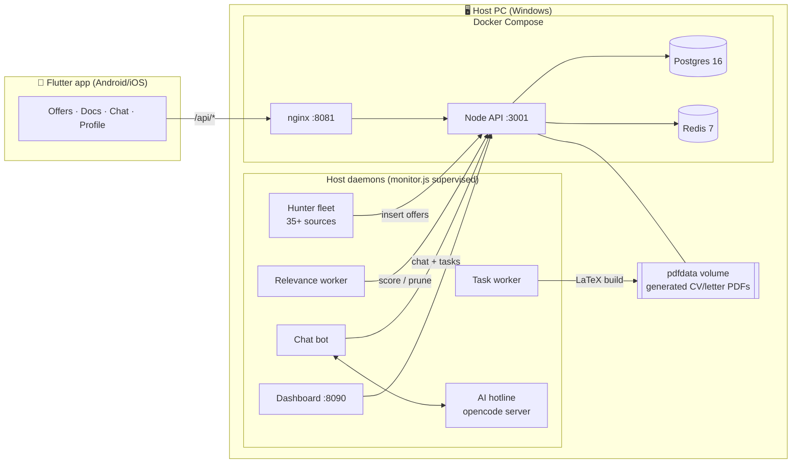

# JobHunter

**A self-hosted job-hunting platform: a Flutter mobile app, a Dockerized Node/Postgres/Redis
backend, a fleet of scraping + matching agents, and an AI assistant — all running on one PC.**

I built this to stop juggling job boards by hand: the system aggregates offers from company
career sites and job boards, scores them against my profile, tailors a LaTeX CV + cover letter
to a chosen offer, and lets me chat with an AI agent that can drive the whole pipeline.

> **Note:** personal data (CV/letter sources, generated PDFs, LinkedIn/GitHub knowledge bases,
> Firebase keys) is intentionally **not** in this repo — it is gitignored. This is the
> engineering showcase.

---

## Architecture



- **Backend** (`api/`, `Dockerfile.api`): Express + `pg` + `redis` + WebSocket. JWT
  anonymous auth, offers CRUD/search/facets, documents, tasks, chat, profile, devices.
- **Reverse proxy** (`nginx.conf`): `/api/` and `/ws/` → API. Optional **Cloudflare Tunnel**
  profile for phone access from anywhere (no port-forwarding).
- **Daemon fleet** (`app/daemon/`): a supervisor (`monitor.js`) respawns workers declared in
  `agents.json` — a scraper fleet across 35+ job sources, a relevance scorer, a document task
  worker, a chat bot, an AI "hotline", and health/audit jobs.
- **Flutter app** (`app/jobcenter/`): offers board (search, facets, detail, status), docs
  (open/share generated PDFs), chat (main + AI hotline), profile, sources, devices.
- **Dashboard** (`dashboard/`): zero-build vanilla-JS SPA with a tiny static+proxy server,
  the same features as the app for desktop (http://localhost:8090).

---

## Tech stack


---

## Features

- **Multi-source offer aggregation** — a per-source scraper fleet (company career pages +
  job boards) feeding a deduplicated `offers` table via Redis-known-offer tracking.
- **Relevance scoring & band pruning** — an LLM-assisted relevance worker scores offers, keeps
  an un-judged "band" with a TTL, and prunes the noise.
- **On-demand document generation** — "adapter &lt;ref&gt;" (chat, or the *Adapter* button)
  queues a task that runs the LaTeX pipeline (`tailored/gen_tailored.py`) and produces a
  **1-page tailored CV + cover letter** PDF per offer, stored in a Docker volume.
- **AI assistant ("hotline")** — the app chat can route to a headless AI coding agent that
  inspects the live system and runs actions (adapter, apply, status queries), with a streaming
  progress UX and deterministic safety for apply flows.
- **Mobile + desktop clients** — Flutter app and a dependency-free web dashboard against the
  same REST API.
- **Self-hosting first** — everything (DB, cache, API, proxy, tunnel) runs via Docker Compose;
  anonymous JWT auth keeps the phone↔PC link simple.

---

## Repository layout

```
.
├── api/                     # Node/Express API (Postgres + Redis + ws)
├── app/
│   ├── daemon/              # host workers: supervisor, scrapers, task/chat workers
│   └── jobcenter/           # Flutter application
├── dashboard/               # vanilla-JS SPA + zero-dep static/proxy server
├── tailored/                # LaTeX CV/letter generator (gen_tailored.py) + payloads
├── scripts/                 # ops helpers (skeleton check, purge, audits)
├── Dockerfile.api           # API image (Node 24)
├── docker-compose.yml       # postgres · redis · api · nginx · (optional cloudflared)
├── nginx.conf
└── .env.example             # copy to .env and fill secrets
```

---

## Quick start

```bash
# 1. Create the env file and fill in the required secrets
cp .env.example .env

# 2. Build and start the stack
docker compose up -d --build

# 3. Check health
docker compose ps
curl http://localhost:8081/api/health      # -> {"ok":true}

# 4. Mint an anonymous JWT
curl -X POST http://localhost:3001/api/auth/anon \
  -H "Content-Type: application/json" -d "{\"uid\":\"pc\"}"
```

Required secrets in `.env`: `POSTGRES_PASSWORD`, `REDIS_PASSWORD`, `JWT_SECRET`
(generate each with `openssl rand -hex 32`). See `.env.example` for ports and optional
AI/hotline settings.

### Run the Flutter app

```bash
cd app/jobcenter
flutter pub get
flutter run --dart-define=API_BASE_URL=http://<your-host>:8081
```

### Run the daemons

```bash
cd app/daemon
npm install
node monitor.js          # supervises every worker in agents.json
```

The web dashboard is served separately by `node dashboard/serve.js` (http://localhost:8090).

### Expose the API to a phone anywhere (optional)

```bash
# quick, ephemeral tunnel
docker run --rm cloudflare/cloudflared tunnel --url http://host.docker.internal:8081

# or a stable named tunnel
# set TUNNEL_TOKEN in .env, then:
docker compose --profile cloudflare up -d
```

---

## Configuration highlights (`.env`)

| Key | Purpose |
| --- | --- |
| `POSTGRES_PASSWORD` / `REDIS_PASSWORD` / `JWT_SECRET` | required secrets |
| `API_PORT` / `NGINX_PORT` / `POSTGRES_PORT` / `REDIS_PORT` | host ports (defaults 3001/8081/5433/6380) |
| `TUNNEL_TOKEN` | Cloudflare Tunnel token (empty = local only) |
| `HUNTER_INTERVAL_MS` | scrape cadence (default 5 min) |
| `AUTO_TAILOR` | `0` = documents only on demand (default), `1` = auto-queue |
| `OPENCODE_HOTLINE_*` | AI hotline model/streaming settings |

---

## CV/letter pipeline

`tailored/gen_tailored.py` takes an offer payload and emits a tailored CV + letter. The
master documents keep a **frozen skeleton** (layout, section order, contact block) while only
the content inside explicit `%%%TXR-…%%%` markers adapts to the offer — enforced by
`scripts/check_skeleton.js` so tailored output can never drift from the 1-page master.

---

## License

Personal project, provided for demonstration. Third-party LaTeX CV templates and scraped data
are not included. Add a license here if you intend to reuse the code.
